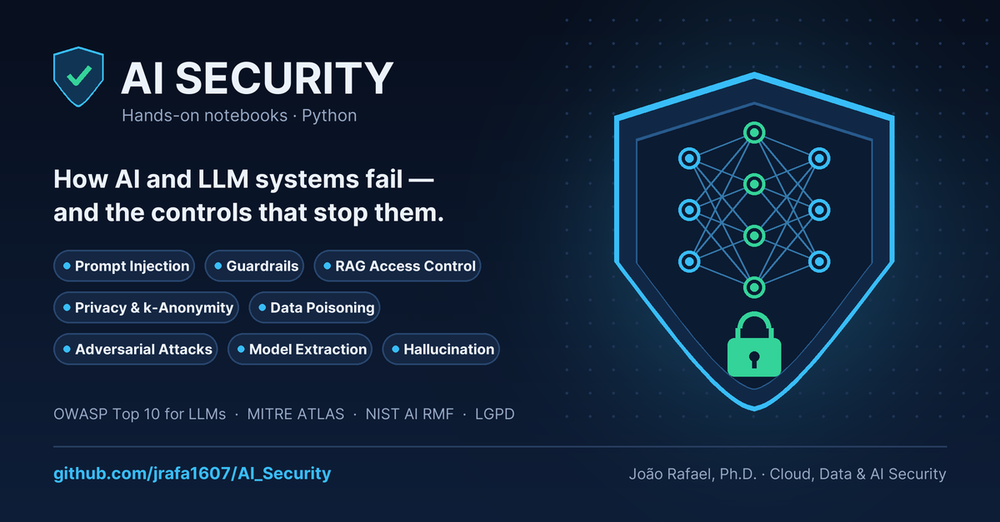

### 🛡️🔐 AI Security

Hands-on Python notebooks on **AI and LLM security**. Each one shows how an AI system fails and which control mitigates the failure, using small, reproducible examples with synthetic data.

---

#### 📓 Notebooks

* **[Prompt Injection](https://colab.research.google.com/github/jrafa1607/AI_Security/blob/main/Prompt_Injection.ipynb)** — direct and indirect injection, and how to contain it *(LLM01)*
* **[Guardrails](https://colab.research.google.com/github/jrafa1607/AI_Security/blob/main/Guardrails.ipynb)** — input, tool, and output controls around an LLM *(LLM01, LLM02, LLM05, LLM06, LLM07)*
* **[RAG Access Control](https://colab.research.google.com/github/jrafa1607/AI_Security/blob/main/RAG_Access_Control.ipynb)** — retrieval that respects permissions *(LLM02, LLM08)*
* **[Privacy and Data Minimization](https://colab.research.google.com/github/jrafa1607/AI_Security/blob/main/Privacy_And_Data_Minimization.ipynb)** — masking, pseudonymization, and k-anonymity *(LLM02)*
* **[Data Poisoning](https://colab.research.google.com/github/jrafa1607/AI_Security/blob/main/Data_Poisoning.ipynb)** — corrupted labels, backdoors, and detection *(LLM04)*
* **[Adversarial Attacks](https://colab.research.google.com/github/jrafa1607/AI_Security/blob/main/Adversarial_Attacks.ipynb)** — evasion with FGSM and adversarial training *(MITRE ATLAS: evasion)*
* **[Model Extraction and Inversion](https://colab.research.google.com/github/jrafa1607/AI_Security/blob/main/Model_Extraction_And_Inversion.ipynb)** — model theft, membership inference, and inversion *(LLM02, LLM10)*
* **[AI Hallucination](https://colab.research.google.com/github/jrafa1607/AI_Security/blob/main/AI_Hallucination.ipynb)** — grounding and self-consistency checks *(LLM09)*

Codes refer to the [**OWASP Top 10 for LLM Applications**](https://genai.owasp.org/llm-top-10/).  
Each link opens the notebook in **Google Colab**; run it with `Runtime > Run all`. To run locally, use `pip install -r requirements.txt`.

---

#### 🔗📚 References

| Reference | Description |
| --- | --- |
| [NIST AI RMF 1.0](https://nvlpubs.nist.gov/nistpubs/ai/NIST.AI.100-1.pdf) | Framework to govern, map, measure, and manage AI risks |
| [OWASP Top 10 for LLMs](https://genai.owasp.org/llm-top-10/) | The ten most critical security risks in LLM applications |
| [OWASP AI Testing Guide](https://owasp.org/www-project-ai-testing-guide/) | Methodology for security testing of AI systems |
| [MITRE ATLAS](https://atlas.mitre.org/) | Knowledge base of real-world adversary tactics against AI |
| [CSA AI Controls Matrix](https://cloudsecurityalliance.org/blog/2025/07/10/introducing-the-csa-ai-controls-matrix-a-comprehensive-framework-for-trustworthy-ai) | Control framework for trustworthy AI in the cloud |
| [ENISA FAICP](https://www.faicp-framework.com/) | European good practices for AI cybersecurity |
| [ISO/IEC 42001:2023](https://www.iso.org/standard/42001) | Management system standard for AI |
| [ISO/IEC 27090:2026](https://www.iso.org/standard/27090) | Guidance on security threats and controls for AI systems |

---

#### ⚠️ Ethical Use

The attack simulations run only against toy models built inside each notebook and exist **for education and defense**. Do not use these techniques against systems you do not own or are not authorized to test.

---

#### ⚖️ Intellectual Property (IP) Notice

All source code, documentation, and research methodologies contained in this repository are the exclusive Intellectual Property of the author. All rights reserved. Use of this content for academic or professional purposes must include proper citation and attribution to the original research (see [`CITATION.cff`](CITATION.cff)).

**Copyright © 2026 [João Rafael](https://www.linkedin.com/in/jrafa1607/).**
