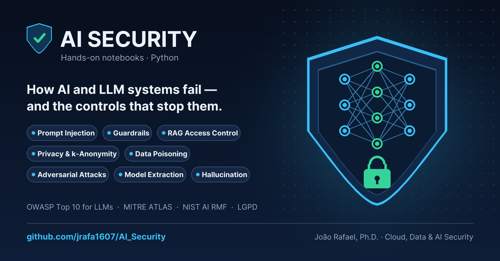

# 🛡️🔐 AI Security

Hands-on Python notebooks on **AI and LLM security**. Each one shows how an AI system fails and which control mitigates the failure, using small, reproducible examples with synthetic data.

---

#### 📓 Notebooks

| Notebook | Focus | OWASP | ATLAS |
| --- | --- | --- | --- |
| [Prompt Injection](https://colab.research.google.com/github/jrafa1607/AI_Security/blob/main/Prompt_Injection.ipynb) | Direct and indirect | LLM01 | T0051 |
| [Guardrails](https://colab.research.google.com/github/jrafa1607/AI_Security/blob/main/Guardrails.ipynb) | Input, tool, output | LLM01–02, 05–07 | T0051, T0054 |
| [RAG Access Control](https://colab.research.google.com/github/jrafa1607/AI_Security/blob/main/RAG_Access_Control.ipynb) | Permission filters | LLM01, 02, 08 | T0051 |
| [Data Minimization](https://colab.research.google.com/github/jrafa1607/AI_Security/blob/main/Privacy_And_Data_Minimization.ipynb) | Masking, k-anonymity | LLM02 | — |
| [Data Poisoning](https://colab.research.google.com/github/jrafa1607/AI_Security/blob/main/Data_Poisoning.ipynb) | Labels and backdoors | LLM04 | T0020 |
| [Adversarial Attacks](https://colab.research.google.com/github/jrafa1607/AI_Security/blob/main/Adversarial_Attacks.ipynb) | FGSM evasion | — | T0015 |
| [Model Extraction](https://colab.research.google.com/github/jrafa1607/AI_Security/blob/main/Model_Extraction_And_Inversion.ipynb) | Theft and membership | LLM02, 10 | T0024 |
| [AI Hallucination](https://colab.research.google.com/github/jrafa1607/AI_Security/blob/main/AI_Hallucination.ipynb) | Grounding, consistency | LLM09 | — |

OWASP codes refer to the [OWASP Top 10 for LLM Applications 2025](https://genai.owasp.org/llm-top-10/); ATLAS IDs refer to [MITRE ATLAS](https://atlas.mitre.org/) techniques (prefix `AML.`). Each link opens the notebook in **Google Colab**; run it with `Runtime > Run all`.  
 
To run locally, use `pip install -r requirements.txt`. Seven notebooks need only NumPy and are executed on every push by the CI. *AI Hallucination* downloads a small model ([Qwen2.5-0.5B-Instruct](https://huggingface.co/Qwen/Qwen2.5-0.5B-Instruct)) and is run manually, since sampled answers vary by design.

---

#### 🔗📚 References

| Reference | Scope |
| --- | --- |
| [OWASP Top 10 for LLMs 2025](https://genai.owasp.org/llm-top-10/) | Top risks in LLM applications |
| [OWASP AI Testing Guide](https://owasp.org/www-project-ai-testing-guide/) | Security testing of AI systems |
| [MITRE ATLAS](https://atlas.mitre.org/) | Adversary tactics against AI |
| [NIST AI RMF 1.0](https://nvlpubs.nist.gov/nistpubs/ai/NIST.AI.100-1.pdf) | AI risk management |
| [NIST AI 600-1](https://nvlpubs.nist.gov/nistpubs/ai/NIST.AI.600-1.pdf) | Generative AI risk profile |
| [NIST AI 100-2 E2025](https://csrc.nist.gov/pubs/ai/100/2/e2025/final) | Adversarial ML taxonomy |
| [CSA AI Controls Matrix](https://cloudsecurityalliance.org/blog/2025/07/10/introducing-the-csa-ai-controls-matrix-a-comprehensive-framework-for-trustworthy-ai) | Controls for trustworthy AI |
| [ENISA FAICP](https://www.enisa.europa.eu/publications/multilayer-framework-for-good-cybersecurity-practices-for-ai) | EU AI cybersecurity practices |
| [ISO/IEC 42001:2023](https://www.iso.org/standard/42001) | AI management system |
| [ISO/IEC 27090:2026](https://www.iso.org/standard/27090) | AI security threats and controls |

---

#### ⚠️ Ethical Use

The attack simulations run only against toy models built inside each notebook and exist **for education and defense**. Do not use these techniques against systems you do not own or are not authorized to test.

---

#### 📝 How to Cite

GitHub shows a **Cite this repository** button generated from [`CITATION.cff`](CITATION.cff). APA format:

> Evangelista, J. R. G. (2026). *AI Security: Hands-on Notebooks on AI and LLM Security, Privacy, and Robustness* (Version 1.1.0) [Computer software]. https://github.com/jrafa1607/AI_Security

---

#### ⚖️ Intellectual Property (IP) Notice

All source code, documentation, and research methodologies contained in this repository are the exclusive Intellectual Property of the author. All rights reserved. Use of this content for academic or professional purposes must include proper citation and attribution to the original research (see [How to Cite](#-how-to-cite)).

**Copyright © 2026 [João Rafael](https://www.linkedin.com/in/jrafa1607/).**
